

# GoCart

**Shop. Sell. Govern.**

A multi-vendor e-commerce marketplace where customers buy, sellers run their
own stores, and admins keep the platform honest, all on one PostgreSQL schema.

[Product tour](#product-tour) ·
[Database design](./docs/database-design.md) ·
[API overview](#api-overview) ·
[Get started](#get-started)

<picture>
<source media="(prefers-color-scheme: dark)" srcset="./.github/assets/readme/gocart-home.jpg" />

</picture>

[Product tour](#product-tour) · [How an order moves](#how-an-order-moves) ·
[Seller approval](#seller-approval) · [Data model](#data-model) ·
[Architecture](#architecture) · [Security](#security) ·
[Quality](#quality) · [Get started](#get-started) ·
[Status](#project-status-and-next-steps)

GoCart brings a storefront, merchant tools and a governance console into one
app. Customers browse products from many sellers and check out in one order;
sellers manage their own catalogue and move orders along; admins approve
merchants, curate categories and watch the marketplace. The rules that matter
(stock, seller status, checkout) live in PostgreSQL itself, so the API cannot
step around them.

## At a glance

| | |
| --- | --- |
| **Three roles, one data set** | Customers, sellers and admins each get a workspace on the same tables. |
| **Where it runs** | A React 19 single-page app and an Express 4 API served from one Node process, in dark and light themes. |
| **Rules in the database** | 13 tables, 58 SQL functions, 8 triggers and 1 stored procedure keep stock, seller status and order history consistent. |
| **Trust built in** | Merchants are approved by an admin before they can list; suspended or rejected sellers are blocked by a database trigger. |
| **Safe checkout** | One transaction locks the cart and the products, checks stock, creates the order, takes the stock and empties the cart. |
| **Sessions you can revoke** | HttpOnly `SameSite=Strict` JWT cookies, with every token ID stored so logging out invalidates it on the server. |
| **Verified** | `npm run lint` type-checks the project, `npm run build` bundles it, and `npm test` runs the admin-seeding tests. |

## Who does what

| Role | Gets | Needs approval? |
| --- | --- | --- |
| **Customer** | Catalogue with search, category filters, price slider and stock filter; trending, top-rated and top-seller panels; cart; checkout; order history with tracking IDs; product reviews; profile and address | No, anyone can register |
| **Seller** | Product listings (create, edit, change status, delete); incoming orders with a status selector; store totals for products, revenue and orders; customer reviews of their products | Yes, an admin must approve the store |
| **Admin** | Governance dashboard with market value, order throughput and review sentiment; seller approvals and suspensions; category registry; product moderation; admin accounts | Not self-service: only a signed-in admin can create another admin |

## Try it

| Role | What you can try |
| --- | --- |
| Customer | Register from the landing page, then browse, add to cart and check out. |
| Seller | Register as a merchant. The store stays `pending` until an admin approves it. |
| Admin | Set `GOCART_ADMIN_EMAIL` and `GOCART_ADMIN_PASSWORD` (12 or more characters) before the first start to create the first admin. |

The demo seed ships four categories, four sellers (one pending), six products
and a few orders, and **no passwords**, so there is no default login. Run it
yourself with the steps in [Get started](#get-started).

## Product tour

The images below are real captures of the running app. They were taken from a
local build against a throwaway PostgreSQL-compatible database, using sample
data written for the purpose: names and prices are invented, and product,
seller and logo pictures are generated placeholders, because the machine that
took the captures had no internet to load the photos the app normally links to.
Nothing comes from a production account.

<table>
<tr>
<td width="50%" valign="top">
<picture>
<source media="(prefers-color-scheme: dark)" srcset="./.github/assets/readme/gocart-sign-in.jpg" />

</picture>

<b>Sign in.</b> One dialog for every role, with the role decided by the account.

</td>
<td width="50%" valign="top">
<picture>
<source media="(prefers-color-scheme: dark)" srcset="./.github/assets/readme/gocart-sign-up.jpg" />
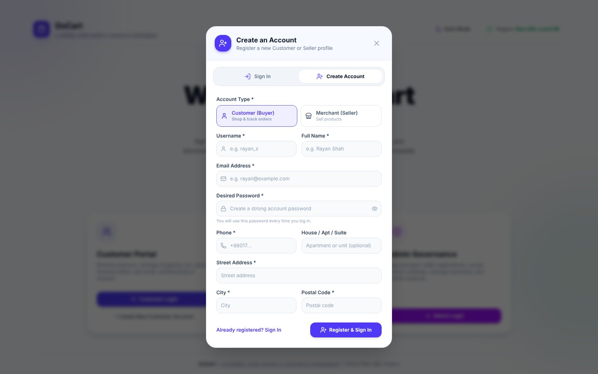
</picture>

<b>Create an account.</b> Customers and merchants register themselves; admins cannot.

</td>
</tr>
</table>

<picture>
<source media="(prefers-color-scheme: dark)" srcset="./.github/assets/readme/gocart-mobile-landing.jpg" />
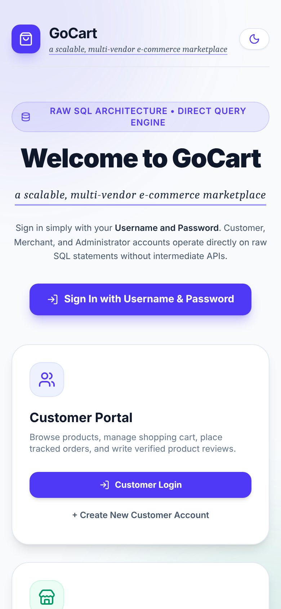
</picture>
<picture>
<source media="(prefers-color-scheme: dark)" srcset="./.github/assets/readme/gocart-mobile-storefront.jpg" />

</picture>

<b>On a phone.</b> The same app at a 390-pixel viewport: the portals stack, and the catalogue becomes a single column.

### Inside each workspace

#### Customer

<table>
<tr>
<td width="50%" valign="top">
<picture>
<source media="(prefers-color-scheme: dark)" srcset="./.github/assets/readme/app-customer-storefront.jpg" />
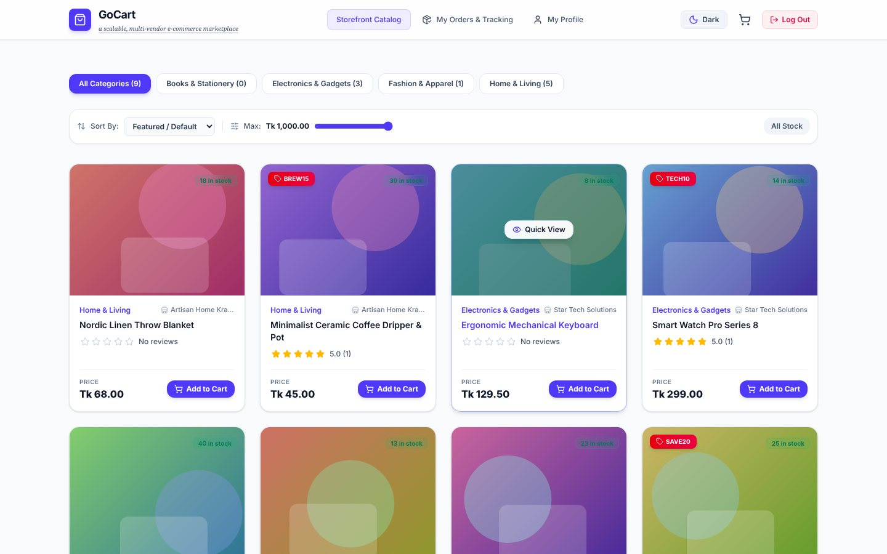
</picture>

<b>Shop the catalogue.</b> Products from several sellers in one grid, with category chips, sorting, a price cap and a stock filter.

</td>
<td width="50%" valign="top">
<picture>
<source media="(prefers-color-scheme: dark)" srcset="./.github/assets/readme/app-customer-product.jpg" />
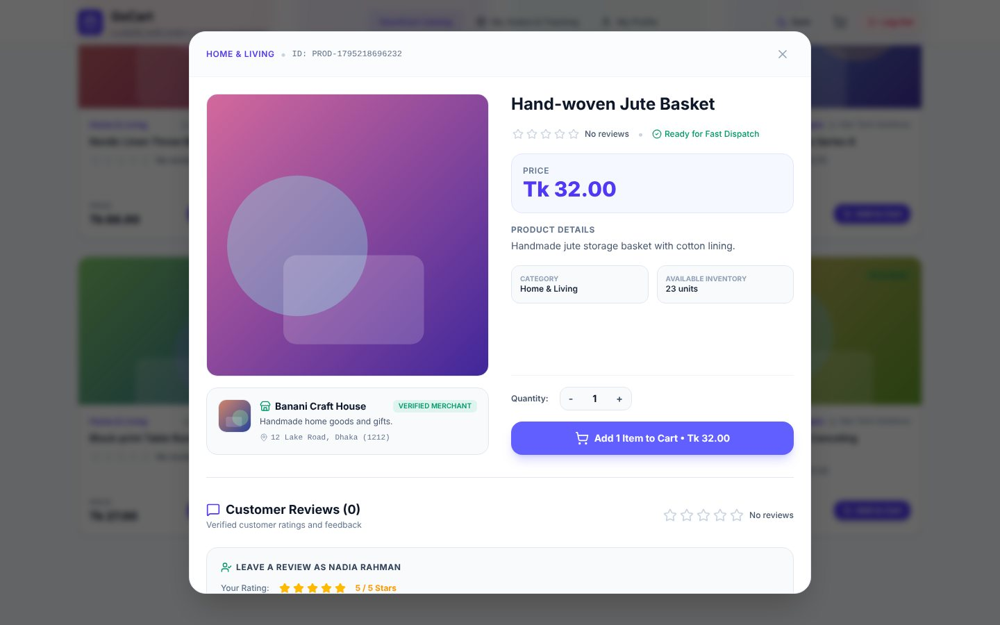
</picture>

<b>Review the details.</b> Price, stock left, the merchant and their address, and a quantity picker before adding to the cart.

</td>
</tr>
<tr>
<td width="50%" valign="top">
<picture>
<source media="(prefers-color-scheme: dark)" srcset="./.github/assets/readme/app-customer-cart.jpg" />
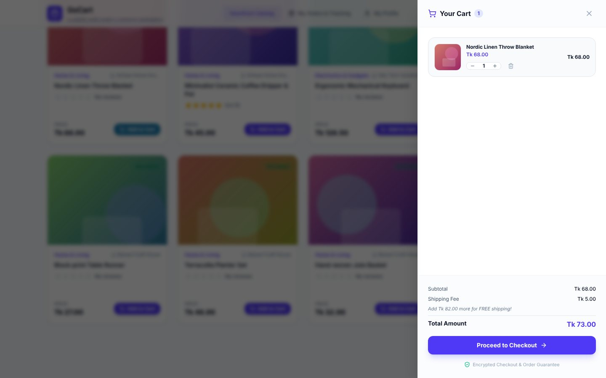
</picture>

<b>Check the cart.</b> Subtotal, shipping and a hint on how much more earns free shipping (orders over 150).

</td>
<td width="50%" valign="top">
<picture>
<source media="(prefers-color-scheme: dark)" srcset="./.github/assets/readme/app-customer-checkout.jpg" />
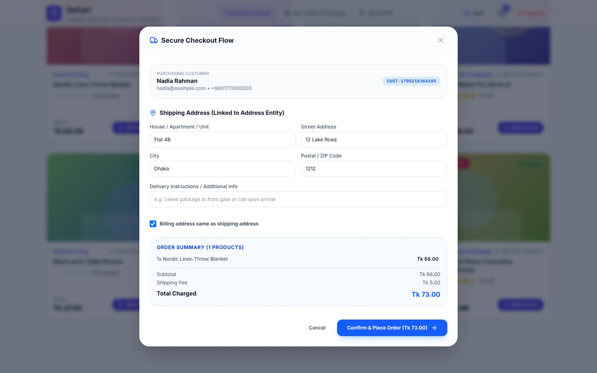
</picture>

<b>Check out.</b> Confirm the address, add delivery notes and place the order in one step.

</td>
</tr>
<tr>
<td width="50%" valign="top">
<picture>
<source media="(prefers-color-scheme: dark)" srcset="./.github/assets/readme/app-customer-orders.jpg" />
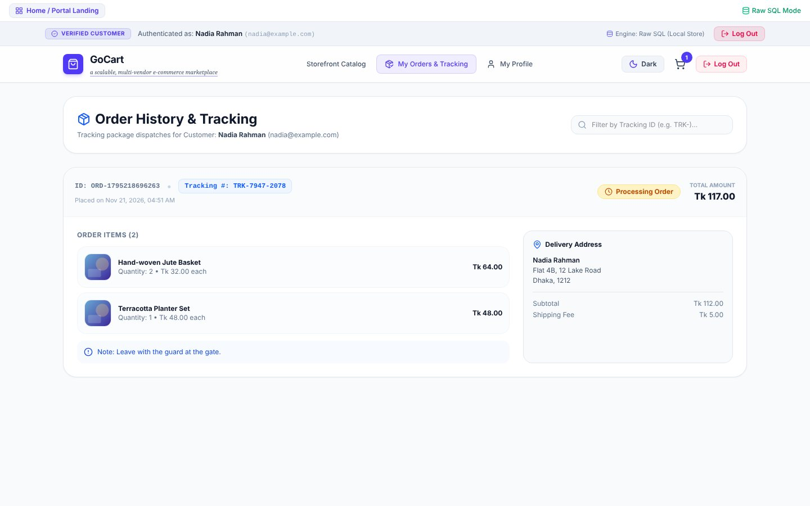
</picture>

<b>Follow the order.</b> Each order has a tracking ID, a status badge, its items and the delivery address.

</td>
<td width="50%" valign="top">
<picture>
<source media="(prefers-color-scheme: dark)" srcset="./.github/assets/readme/app-customer-profile.jpg" />
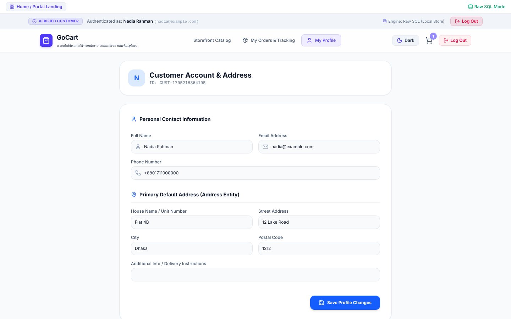
</picture>

<b>Keep a profile.</b> Contact details and a default address, saved back to the customer record.

</td>
</tr>
</table>

#### Seller

<table>
<tr>
<td width="50%" valign="top">
<picture>
<source media="(prefers-color-scheme: dark)" srcset="./.github/assets/readme/app-seller-catalog.jpg" />
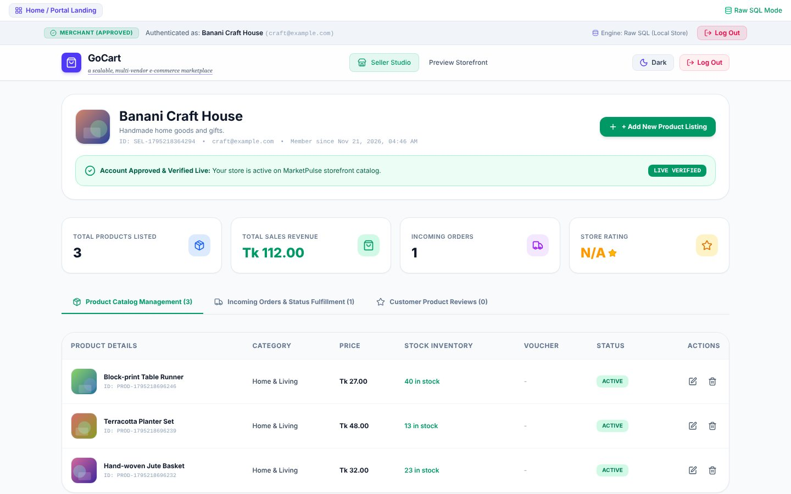
</picture>

<b>Run the catalogue.</b> An approved store sees its products, stock and status next to totals for revenue and orders.

</td>
<td width="50%" valign="top">
<picture>
<source media="(prefers-color-scheme: dark)" srcset="./.github/assets/readme/app-seller-new-product.jpg" />
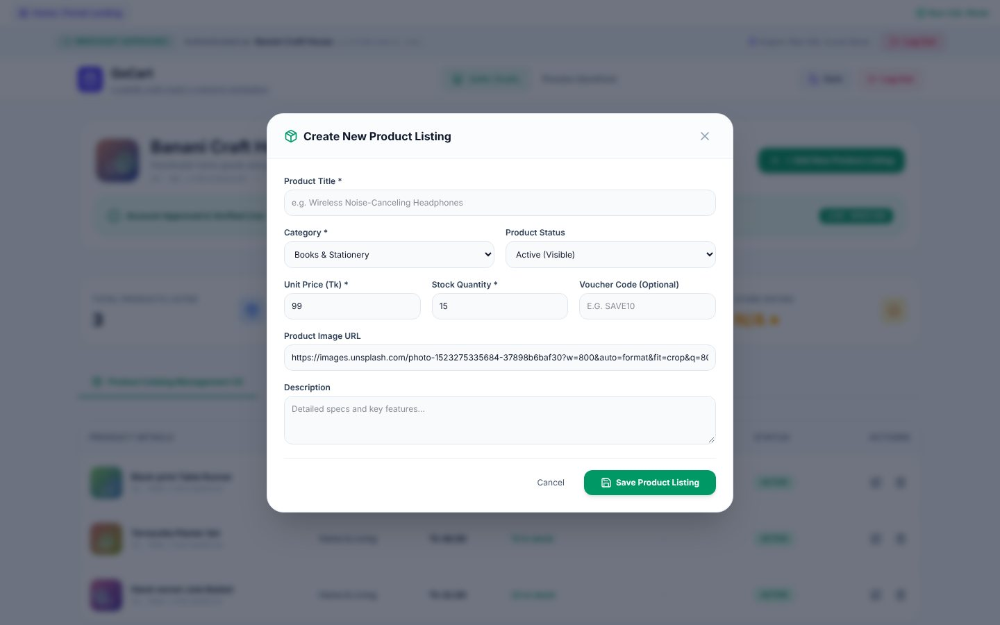
</picture>

<b>List a product.</b> Title, category, status, price, stock, an optional voucher code, an image URL and a description.

</td>
</tr>
<tr>
<td width="50%" valign="top">
<picture>
<source media="(prefers-color-scheme: dark)" srcset="./.github/assets/readme/app-seller-fulfillment.jpg" />
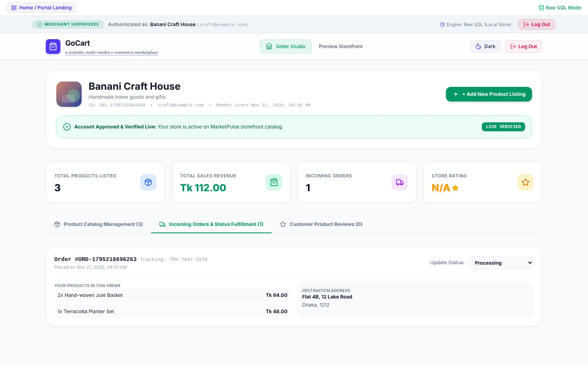
</picture>

<b>Fulfil orders.</b> Each order lists this seller's items and the destination; a selector moves it through the statuses.

</td>
<td width="50%" valign="top">
<picture>
<source media="(prefers-color-scheme: dark)" srcset="./.github/assets/readme/app-seller-reviews.jpg" />
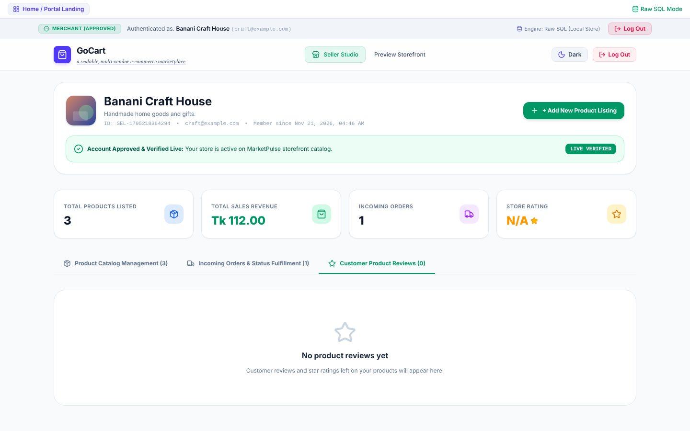
</picture>

<b>Read the feedback.</b> Customer reviews of the seller's products, in one place.

</td>
</tr>
</table>

#### Admin

<table>
<tr>
<td width="50%" valign="top">
<picture>
<source media="(prefers-color-scheme: dark)" srcset="./.github/assets/readme/app-admin-overview.jpg" />
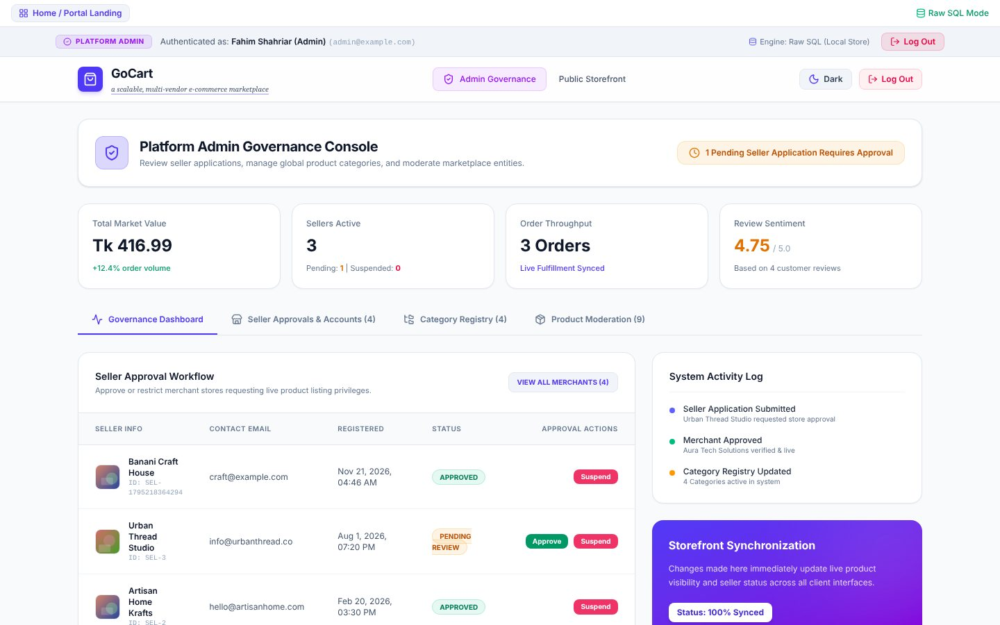
</picture>

<b>Oversee the marketplace.</b> Market value, active sellers, order throughput and review sentiment at a glance, with the approval queue below.

</td>
<td width="50%" valign="top">
<picture>
<source media="(prefers-color-scheme: dark)" srcset="./.github/assets/readme/app-admin-sellers.jpg" />
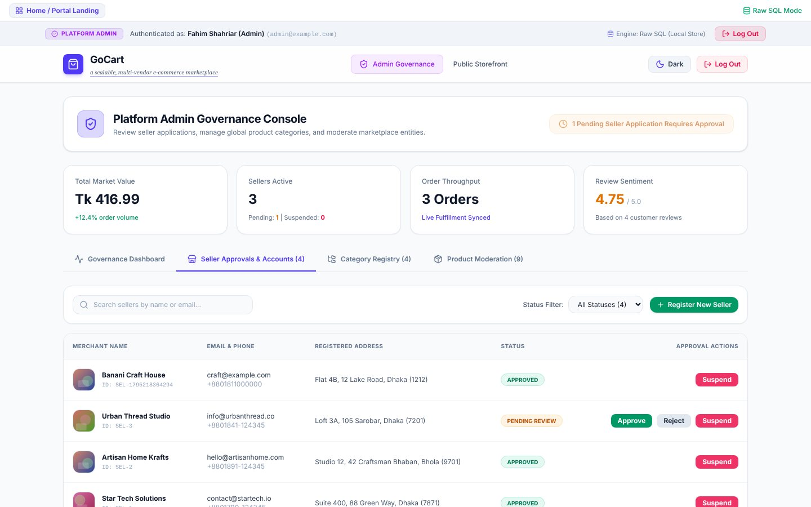
</picture>

<b>Approve merchants.</b> Pending stores are approved or rejected; live ones can be suspended.

</td>
</tr>
<tr>
<td width="50%" valign="top">
<picture>
<source media="(prefers-color-scheme: dark)" srcset="./.github/assets/readme/app-admin-categories.jpg" />
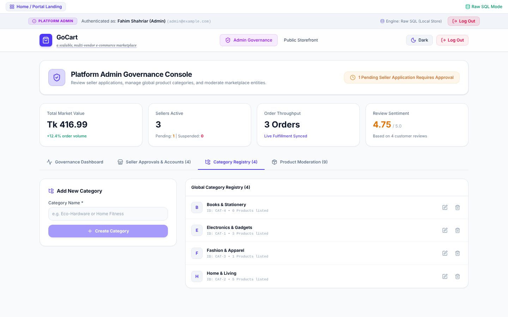
</picture>

<b>Curate categories.</b> Add, rename and remove categories, each with its product count.

</td>
<td width="50%" valign="top">
<picture>
<source media="(prefers-color-scheme: dark)" srcset="./.github/assets/readme/app-admin-products.jpg" />
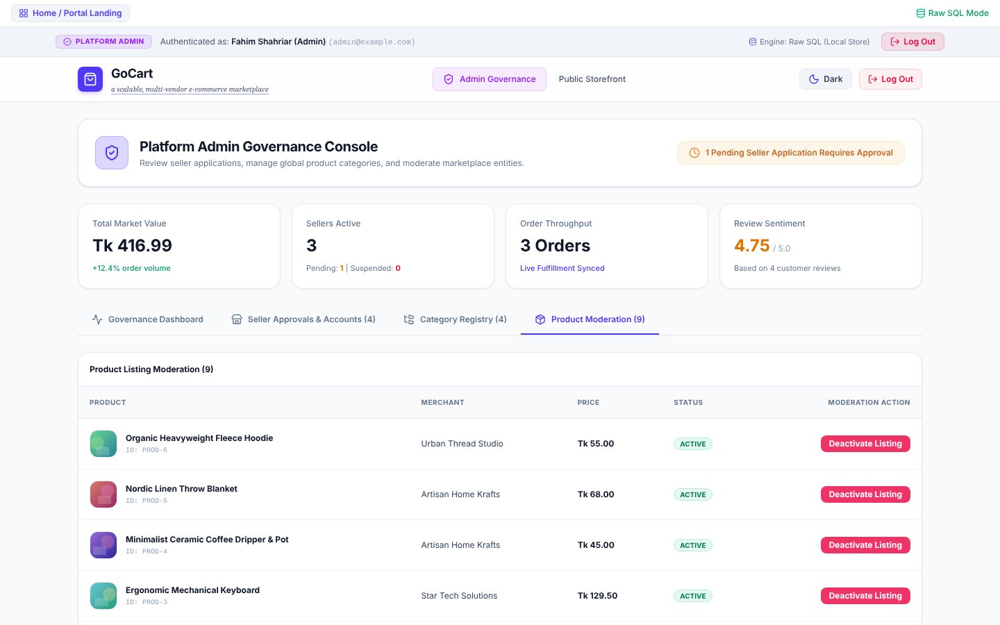
</picture>

<b>Moderate products.</b> Every listing with its merchant, price and status, and a button to deactivate it.

</td>
</tr>
</table>

## How an order moves

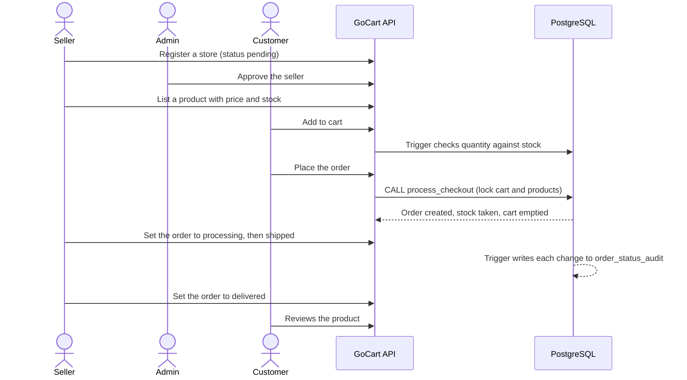

### Statuses

| Thing | Statuses, in the usual order | Notes |
| --- | --- | --- |
| Seller | `pending` → `approved` · `rejected` · `suspended` | Only approved sellers can list; a trigger blocks product writes from suspended or rejected ones |
| Order | `placed` → `processing` → `shipped` → `delivered` · `cancelled` | Sellers and admins move it; every change is logged |
| Product | `active` · `inactive` · `deactivated` | Checkout refuses products that are no longer active |

Shipping is a flat 5 for orders up to 150 and free above that. The browser
works the fee out and sends it with the order, which the server accepts as long
as it is not negative (see [Project status](#project-status-and-next-steps)).

## Seller approval

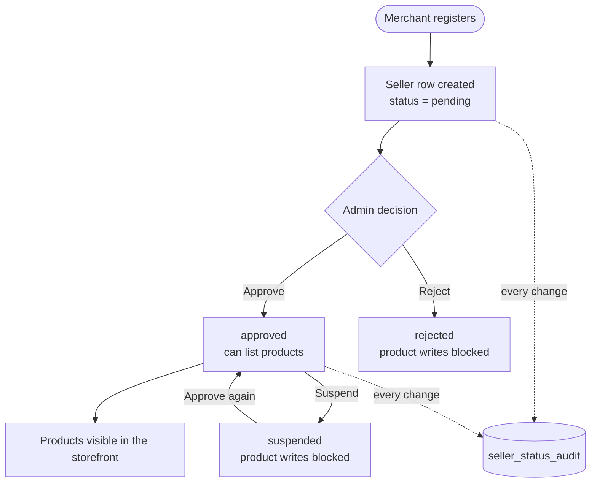

A seller who is not `approved` cannot create a product, and the check lives in a
trigger (`trigger_enforce_seller_status`), so it holds for every caller, not
only the web app.
